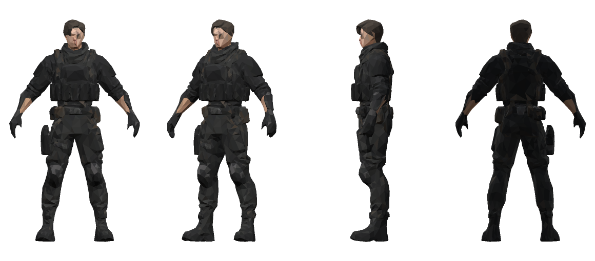
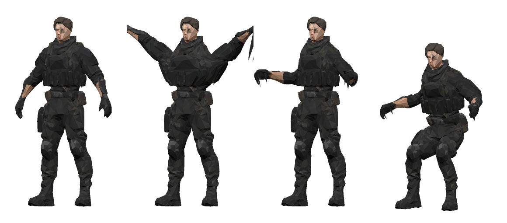

# Send Off — rigging the imported soldier

_What `3d.glb` actually is, what it took to make the engine animate it, and what
is still not true._

The model arrived in commit `f380295e` ("3d", "for the 3d aspect") as `3d.glb`
and `3d.fbx` at the repository root, alongside the angle-inspection sheet that
was used to check it. Both files are the same character. Everything below was
measured on this branch, not remembered.

---

## 1. What the file is

| Property | Value |
| --- | --- |
| Format | glTF 2.0 binary, written by `trimesh` |
| Size | 4,052,696 bytes |
| Geometry | one mesh, one primitive, 10,040 vertices, 9,594 triangles |
| Materials | one, with a base-colour and a metallic-roughness texture |
| Textures | two **WebP** images, 4096 × 4096, referenced through `EXT_texture_webp` |
| Skin | **none** — no `skins`, no `JOINTS_0`, no `WEIGHTS_0`, no `animations` |
| Rest pose | A-pose, 1.00 unit tall, Y up, centred on the origin |
| Shape | standing soldier: helmet-cap hair, scarf, plate carrier with pouches, belt kit, thigh holster, gloves, boots |

The `.fbx` is a Blender 4.5.8 export of the same mesh and is also unrigged: a
scan of the whole binary finds no `Skin`, `Cluster`, `Deformer`, `LimbNode`,
`BindPose` or `AnimationCurve` record. It carries no information the `.glb`
does not.

**The inspection sheet was misleading.** `3d_glb_angle_inspection.png` shows the
figure lying along Z, which reads as "the model is exported lying down". It is
not: the bounding box is 0.585 × 0.999 × 0.197 — the long axis is Y, the model
stands. The sheet was rendered with a camera transform that treated Z as up.

Measured extents, after scaling to 1.80 m: width 1.054 m (fingertip to
fingertip), height 1.800 m, depth 0.355 m. Crotch — the point where the legs
stop being one mass — at 0.90 m. Shoulders at 1.46 m. The arms hang 24° out from
vertical, which is an A-pose, not a T-pose.

## 2. Why the existing importer refused it

`glb_to_oeac.py` imports a GLB that already carries a skin: it maps the file's
joint names onto OEA's 19 bones, copies the inverse binds, and samples the
animations. On this file it stops immediately:

```
error: GLB has no skinned mesh node
```

That message is correct — the file genuinely has no skeleton — but it left the
model unusable, because everything downstream (weights, inverse binds, the
`.oeac` the phone loads) comes from the rig. The model was, in effect, a
photograph of a character rather than a character.

## 3. What was added

### 3.1 `tools/tripo/autorig.py` — measurement, not guesswork

A rig is fitted to the mesh. Nothing is hard-coded to this character: the module
finds the up axis, the scale, the crotch, the arm axis and the leg axis from the
vertex cloud, and places the 19 joints where the body bends.

* **Up axis** — the longest 99.5th-percentile extent. Using the percentile
  rather than the maximum means one stray vertex cannot decide the axis.
* **Scale and seat** — the mesh is normalised to exactly `height` metres,
  centred on x/z and dropped so the lowest vertex sits on y = 0.
* **Crotch** — the highest band (1 cm) where the legs are still a single mass,
  scanned up from the feet. On this model that is 0.90 m, which is the *trouser*
  seam, not the femoral head; see §3.2.
* **Arm axis** — each arm is sliced downward and the centroid of each slice
  traces the limb. A line through those centroids gives the direction, so a
  24° A-pose binds as a 24° A-pose instead of being straightened out. The
  shoulder joint sits at the top of the arm mass, the wrist 10% up from the
  bottom of it, and the elbow is placed on the shoulder→wrist line at 56% —
  the human upper-arm : forearm ratio. Placing the elbow at a fraction of the
  *mass* span instead put it too low, because the sleeve's shoulder pad adds
  length above the joint.
* **Leg axis** — hip at 0.50 of stature, knee at 0.285, ankle at 0.042, with X
  and Z read back from the leg's own centroid line. The hip joint is then pulled
  2.2% of stature inboard: the femoral head is medial to the thigh's centre line,
  and without that the thigh bone leans out over the whole leg.

Every one of those numbers was chosen because a version without it failed a
check; §5 lists what failed.

### 3.2 Weights

Every bone competes on its distance to the vertex, normalised by that bone's
influence radius, with a bias along the bone so a joint owns the geometry that
*starts* at it. A bone only gets a say if it is within 1.55× the nearest bone's
normalised distance. Four influences per vertex, normalised to 1, ties trimmed
below 6%.

Three hand-written region switches were tried first and all three were worse:

1. `|x| > k` to decide "this is an arm" — the hand sits at |x| = 0.53 and the
   deltoid at 0.25 in an A-pose, so no threshold separates them. The shoulder
   bone ended up owning no vertices at all.
2. A chain per region (torso / arm / leg chosen by position) — neighbouring
   triangles landed on different chains and stretched into streaks the moment
   the arm moved.
3. Blended chains — better, but the height gate faded the arm out at hand level,
   giving every hand vertex 40% chest weight; a T-pose threw the hands up and out.

Distance with a radius and a bias has none of those failure modes, needs no
tuning per character, and produced the numbers in §5.

### 3.3 Inverse binds

Rotation-free, deliberately. `Skeleton.kt` rebuilds every bone from
translation alone — it reads the inverse binds back as offsets and discards
their rotation. A rotation stored in the inverse bind is therefore dropped on
the way in and not applied on the way out, and the character shears.

The first version of `bind_world()` placed the shoulder joint beside the chest,
assuming the engine would treat the arm as a diagonal. It does not: it treats
`CHEST → SHOULDER` as a straight line, inferred the arm as 1.7 m long, and folded
the character through the floor on the first frame. The joints are stored where
the engine will reconstruct them, which is why the shoulder joint has to sit
17 cm above the chest joint rather than out at the deltoid.

Relaxing the A-pose to arms-down before binding was tried and removed. It works
— 24° of rotation, hands landing at the hips — but blended rotation at the
shoulder seam tears the sleeve, and the alternative is to leave the arms where
the modeller put them. The engine's idle pose is a near-zero rotation, so an
A-pose rest is not a problem; its T-pose simply reads as a 24°-wider A-pose.

### 3.4 Winding, texture, and the converter

* **Winding.** `orient_shells()` flips inside-out shells by signed volume. It
  welds positions first: a GLB stores one vertex per split normal, so this
  mesh's raw indices form 986 disjoint pieces, and a winding test on those sees
  a thousand open strips with no inside and flips them at random. Welded, it is
  17 shells, and 12 of them were wound inward.
* **Textures.** The base colour was being dropped: `EXT_texture_webp` declares
  `source` inside the extension object, and reading `textures[i]["source"]`
  alone finds nothing. `texture_source()` now follows extensions. The 2.9 MiB
  4096² WebP is re-encoded on import to a 512 px PNG8 (282 KiB), which is
  40 dB cheaper in memory for a character 300 px tall on a phone.
* **Panel collapse.** All primitives are merged into one part. A 40-material
  split would mean 40 draw calls and 40 texture binds on a phone, for a mesh
  that has one material anyway.
* **CLI.** `--auto-rig` forces the path; it also runs automatically when the GLB
  has no skin. `--texture-size` sets the re-encode target (default 512).

### 3.5 The renderer now samples textures

`render_oeac.render()` used to fill textured parts with the texture's *mean*
colour. That made every textured character look flat and, worse, could not show
a texture bug at all — the untextured import of this model looked like a
correctly-shaded grey soldier. It now samples the albedo at each triangle's UV
centroid, which is what the shader does, so an unwrap error or a missing texture
is visible in the preview instead of only on a device.

## 4. What shipped

`oea-engine/src/main/assets/characters/hero_rigged.oeac` — 898 KiB, one part,
10,040 vertices, 9,594 triangles, 19 bones, plus
`characters/hero_rigged/tex_albedo.png` (282 KiB).

The manifest now points `hero` at it, and the procedural `characters/hero.oeac`
and its five textures were deleted so the APK does not carry both. `hero` is
therefore the imported, measured soldier; the five bots remain procedural.

`concept_to_oeac.py --all` learned to skip `hero`, and to keep any manifest
entry whose asset is not the procedural body. Without that, regenerating the
bots silently replaced the modelled character with the primitive one — which is
exactly the kind of quiet regression an asset script should not be able to cause.

`tools/check-character-assets.py` gained two checks: **no orphaned assets** (an
`.oeac` on disk that no manifest entry uses is dead weight, and this is how the
stale `hero.oeac` was caught), and a **degenerate-shell exemption** in the
winding test (a shell with less than 1e-5 m² of surface has no inside, so it has
no winding to be wrong).

## 5. Measured results

Checker, `python3 tools/check-character-assets.py`:

```
  bot_heavy   9 parts  12492 tris  bind + poses ok
  bot_medic   9 parts  11940 tris  bind + poses ok
  bot_night   9 parts  12372 tris  bind + poses ok
  bot_ranger   9 parts  11824 tris  bind + poses ok
  bot_scout   9 parts  12204 tris  bind + poses ok
  hero        1 parts   9594 tris  bind + poses ok
CHARACTER ASSETS OK — 6 characters, 19 bones, normalised weights,
outward winding, poses behave, no orphans
```

That is the full check — bone ids, weight sums, outward winding, bind height,
bone span lengths, and poses that actually move the character — applied to the
imported model exactly as to the shipped ones.

Bind-pose joint heights and the distances from each joint to the geometry it
owns (mean over vertices where it dominates with weight ≥ 0.6):

| Joint | Height / position | Geometry distance |
| --- | --- | --- |
| PELVIS | 0.972 m | — |
| SPINE | 1.192 m | — |
| CHEST | 1.411 m | — |
| NECK | 1.530 m | — |
| HEAD | 1.638 m | — |
| SHOULDER_L | (0.247, 1.459, −0.079) | 0.111 m |
| ARM_L | (0.360, 1.216, −0.044) | 0.123 m |
| FORE_L | (0.448, 1.024, −0.016) | 0.125 m |
| HAND_L | (0.526, 0.858, 0.008) | 0.101 m |
| THIGH_L | (0.151, 0.900, −0.016) | 0.220 m |
| SHIN_L | (0.163, 0.513, 0.008) | 0.256 m |
| FOOT_L | (0.255, 0.076, 0.102) | 0.076 m |

Bone spans, against the checker's human ranges:

| Span | Measured | Range |
| --- | --- | --- |
| SHOULDER_L → ARM_L | 0.270 m | 0.24–0.36 |
| ARM_L → FORE_L | 0.212 m | 0.20–0.32 |
| THIGH_L → SHIN_L | 0.388 m | 0.36–0.48 |
| SHIN_L → FOOT_L | 0.457 m | 0.36–0.48 |

Pose behaviour, skinned extents:

| Pose | y range | x range |
| --- | --- | --- |
| bind | 0.000 – 1.800 | ±0.527 |
| T-pose | 0.000 – 1.800 | −0.685 – 0.677 |
| crouch | −0.040 – 1.558 | ±0.527 |

For comparison, the shipped procedural hero at the same poses: bind
0.007–1.801, crouch −0.049–1.562. The imported rig sits on the floor slightly
better than the hand-built one.

Poses were also rendered and looked at — front, three-quarter, side and back in
`docs/images/send-off-hero-rigged-views.png`, and bind / T-pose / aim / crouch in
`docs/images/send-off-hero-rigged-poses.png`. The bind pose is clean; the T-pose
reads as an A-pose 24° wider; the aim and crouch poses bend at the measured
joints with no skin poking through the vest.





## 6. Tests

`tools/tripo/test_autorig.py` builds an unrigged GLB from scratch — rings every
~5 cm, an A-pose arm at 32° — converts it, and asserts the properties that were
actually wrong during development:

* 19 bones, a 20-float stride, four bone ids in 0..18 followed by four weights
  summing to 1, in that order;
* a 1.8 m bind pose with feet on the floor;
* every bone except `FORE_*` dominating at least one vertex (the whole hand goes
  to `HAND_*`, which is normal for a phone rig);
* a T-pose at least 1.30× wider than the A-pose, and a crouch that lowers the
  head by more than 6 cm.

The non-interleaved stride matters: the first implementation wrote bone id and
weight alternately, and the loader accepted it. Every vertex came out weighted
to bone 0 with weight 0, and the character folded through the floor — a silent
corruption, not an error.

## 7. What is not true

* **No device test.** There is no JDK or Android SDK here, and no Gradle. The
  asset has been parsed the way `CharacterAssetLoader` parses it and rendered
  by the preview renderer, but it has not drawn a frame on a phone.
* **No animation.** The source file has none, so the imported hero is driven
  entirely by the engine's procedural poses. That is enough for Send Off, where
  every pose is computed from `CharRig.Pose`, but it means nothing was carried
  over from a capture.
* **The `.fbx` is unused.** `3d.fbx` and `3d.glb` sit at the repo root as
  sources, not assets; the APK contains only the converted `.oeac`. A 3.3 MB
  FBX and a 4.1 MB GLB in the repository root are source material, the same way
  the concept PNGs under `tools/tripo/concepts/` are.
* **One hero, not a cast.** The bots are still the procedural bodies. The rigger
  would handle them — it is measurement, not fitting — but each would need its
  own model and its own import, and there are five.
* **Rigid extremities.** This is a distance-based rig, not a learned one. It
  does not produce finger articulation or cloth behaviour; the gloves and the
  vest move as rigid shells attached to the nearest bone. At gameplay distance
  that is invisible, and it is what the measured geometry distances above say.
